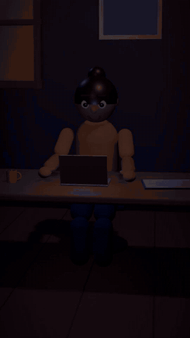
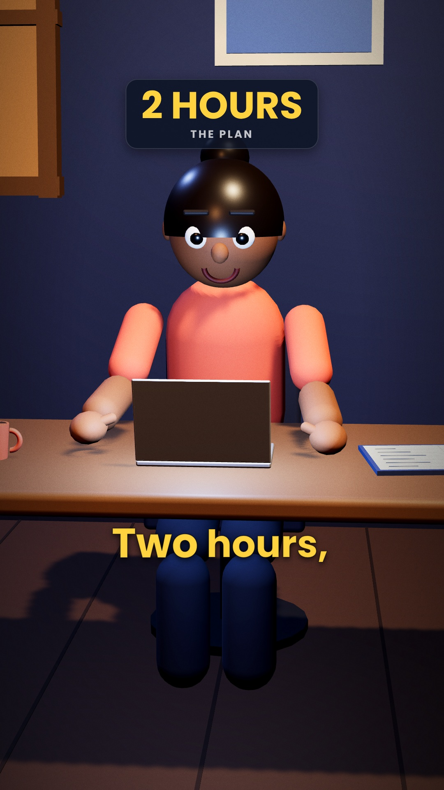
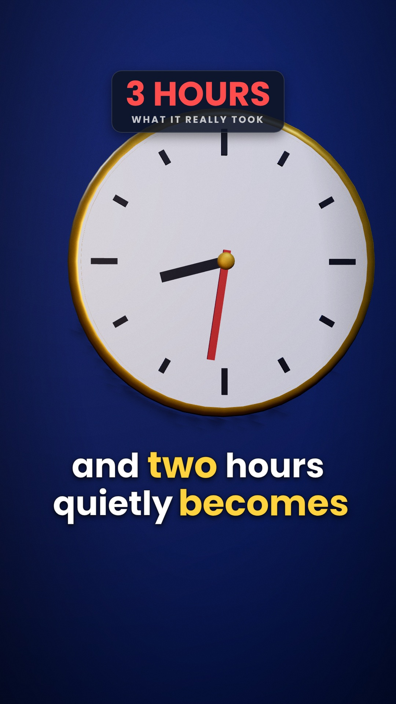
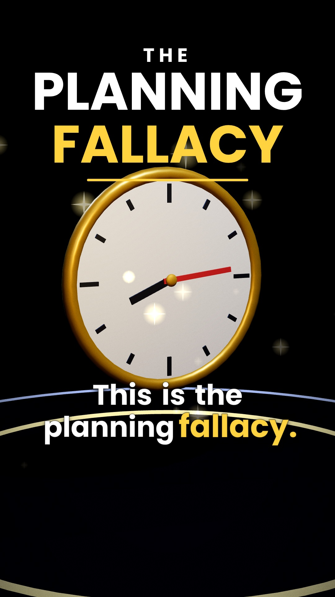
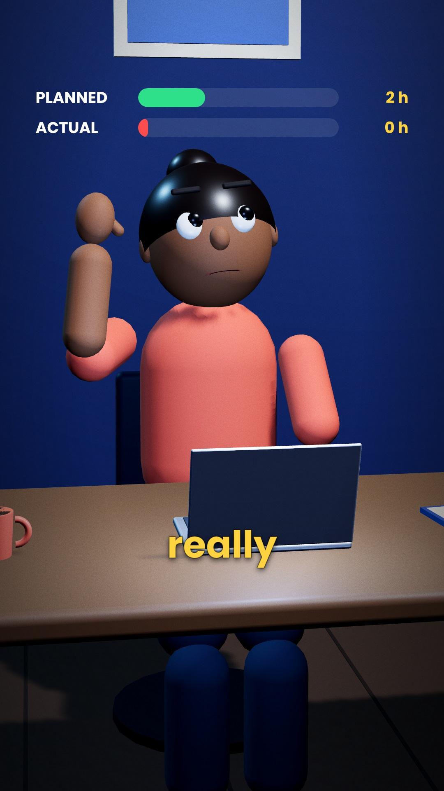
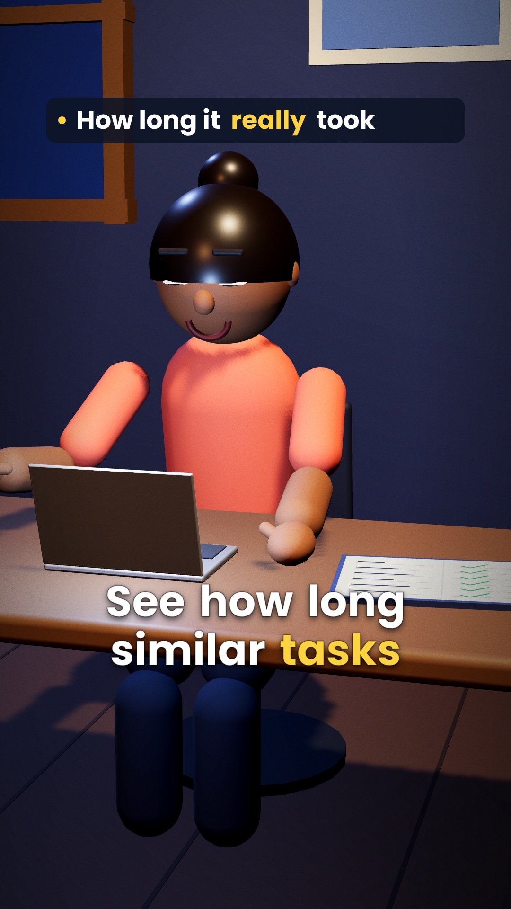
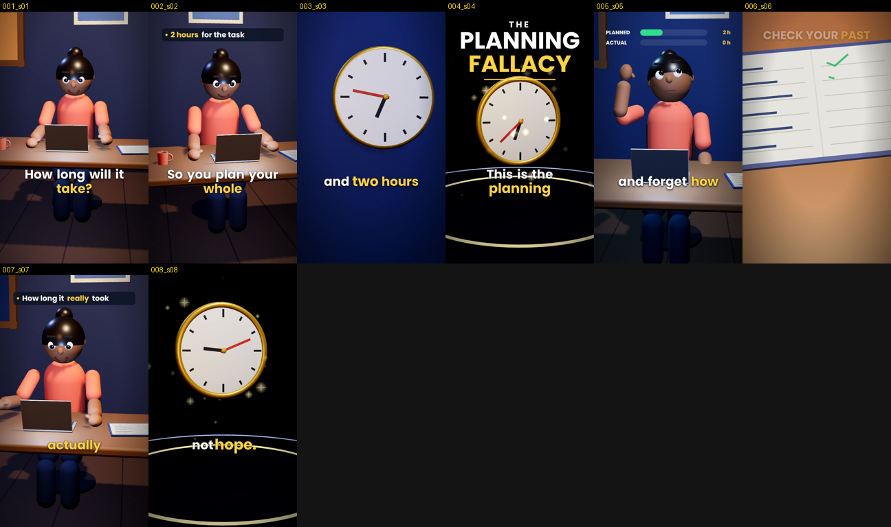
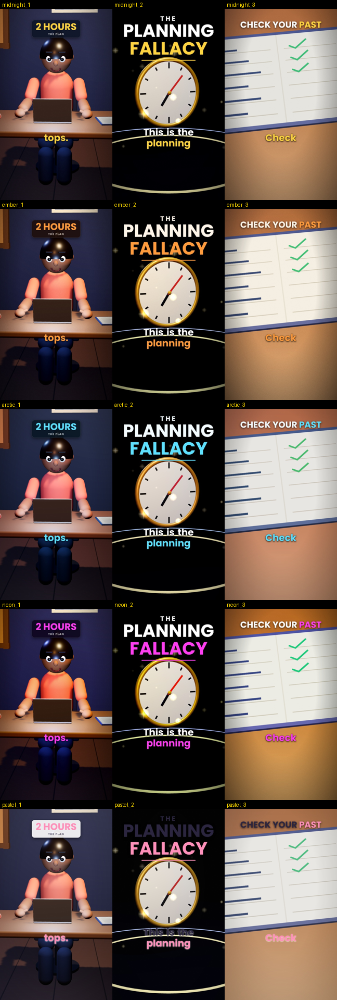

<div align="center">


# Kutuhal 3D

### Upload a script. Get a finished 3D explainer Short.

Claude analyses your script, then generates the **narration, 3D video, music, sound effects and captions** – and hands you an MP4.



*The sample above was produced by the plugin from a 65-word script ([`samples/script_planning_fallacy.txt`](samples/script_planning_fallacy.txt)).*

`Claude · Codex · Gemini CLI · Antigravity` · `9:16 or 16:9` · `720p–4K` · `Kokoro TTS` · `three.js` · `synthesised music + SFX` · `runs offline after setup` · `MIT`

</div>

---

## Contents
1. [What it does](#what-it-does)
2. [Sample output](#sample-output)
3. [Quick start](#quick-start)
4. [Example prompts](#example-prompts)
5. [How it works](#how-it-works)
6. [What is automatic and what is not](#what-is-automatic-and-what-is-not)
7. [Requirements and performance](#requirements-and-performance)
8. [Works with other AI tools](#works-with-other-ai-tools)
9. [What is in this package](#what-is-in-this-package)
10. [Documentation index](#documentation-index)
11. [Limits](#limits-honest-version)
12. [Licence and credits](#licence-and-credits)

---

## What it does

You give Claude a **script** (and optionally instructions such as *"9:16, 45 s, warm female voice, dark style"*). Kutuhal 3D then:

| Step | Result |
|---|---|
| 🧠 **Analyses the script** | scenes, one-idea-per-shot units, key words, a mini "bible" (premise, tone, characters, sets, hero prop, music moods) |
| 🎙️ **Generates the narration** | natural voice-over with Kokoro-82M, 9 voices to audition, every word timed to the millisecond |
| 🎬 **Builds a 3D storyboard and renders it** | low-poly characters, sets, props, moving camera, animated overlays (titles, stats, counters, bars, lists), colour-graded |
| 🎵 **Composes music** | 12 moods (mystery, tension, playful, hopeful, triumph…) that change with the story |
| 🔊 **Designs sound** | ~30 sound effects and 6 ambience beds placed on the exact words, music ducked under the voice, mastered to −14 LUFS |
| 💬 **Burns in captions** | word-by-word, never ahead of the voice; key words highlighted; also exported as `.srt` |
| 📦 **Delivers** | `Title.mp4` + `captions.srt` + `narration.wav` |

## Sample output

**Video:** [`planning_fallacy_1080p.mp4`](https://github.com/swapnilbhange/kutuhal-3d/releases/download/v1.1.0/planning_fallacy_1080p.mp4) (1080×1920, 30.4 s, attached to the v1.1.0 release) · quick preview [`samples/planning_fallacy_540p_preview.mp4`](samples/planning_fallacy_540p_preview.mp4)

| Hook | Counter | Title card |
|:--:|:--:|:--:|
|  |  |  |
| **Comparison bars** | **Top-down notebook** | **Takeaway** |
|  |  |  |

**Contact sheet (one frame per shot)** and **five style presets on the same frames:**





The plan behind it is included in [`samples/example_plan/`](samples/example_plan) (`script.json`, `shots.json`, `words.json`) and the scene code in `plugins/kutuhal-3d/skills/make-3d-short/kit/examples/planning-fallacy/`.

## Quick start

### Step 1 – Install the plugin
Pick **one**:

<details open><summary><b>Claude desktop app, Cowork or claude.ai</b></summary>

1. Open **Customize → Plugins → Add → Upload plugin**.
2. Select [`dist/kutuhal-3d.plugin`](dist/kutuhal-3d.plugin) (if it is rejected, use the identical [`dist/kutuhal-3d.zip`](dist/kutuhal-3d.zip)).
3. Start a new chat; type `/` and you should see `make-3d-short`.
</details>

<details><summary><b>Claude Code (terminal / IDE) – from GitHub</b></summary>

```text
/plugin marketplace add swapnilbhange/kutuhal-3d
/plugin install kutuhal-3d@kutuhal-plugins
```
</details>

<details><summary><b>Claude Code – from a local folder</b></summary>

```text
/plugin marketplace add /path/to/kutuhal-3d
/plugin install kutuhal-3d@kutuhal-plugins
```
or try it without installing: `claude --plugin-dir /path/to/kutuhal-3d/plugins/kutuhal-3d`
</details>

Full details for every platform, plus Windows/macOS/Linux prerequisites: **[docs/INSTALL.md](docs/INSTALL.md)**.

### Step 2 – Attach your script and ask
> *Make a Kutuhal 3D short from this script. 9:16, about 45 seconds, midnight style, captions on.*

Claude asks only what is missing, then runs the whole pipeline. First run downloads the Kokoro voice model (~330 MB).

### Step 3 – Collect the files
`out/<Title>.mp4`, `out/captions.srt`, `out/narration.wav` – and iterate: *"calmer music"*, *"different voice"*, *"show me the five looks"*, *"fix shot 4"*.

**Try it now:** attach [`samples/script_planning_fallacy.txt`](samples/script_planning_fallacy.txt) and say *"Make a 9:16 short from this script."* You should get something like the sample video.

## Example prompts
```text
Make a 9:16 short from this script. 45 seconds max, midnight style, generated music and SFX.

Main character: Maya, a young woman with a bun and a coral top. Recurring prop: a wall clock.
Tone: curious and gentle. Title card on the line that names the concept.

Audition voices first, then wait for my choice.

Same video, calmer music and SFX 3 dB quieter – re-mix only.
```
More in **[docs/PROMPTS.md](docs/PROMPTS.md)**. How to write scripts that work best: **[docs/SCRIPT-GUIDE.md](docs/SCRIPT-GUIDE.md)**.

## How it works

```
script ─▶ ANALYSE ─▶ NARRATE ─▶ STORYBOARD ─▶ BUILD 3D SCENES ─▶ RENDER ─▶ SOUND + MUX ─▶ MP4
          scenes,     Kokoro     shots.json      Claude writes     headless   music, SFX,
          bible       + word     (cue sheet)     scene modules     Chrome +   ambience,
                      timings                    for the engine    three.js   ducking, LUFS
```
`story/shots.json` + `timeline/words.json` are the single source of truth, so picture, captions and sound always agree. Deep dive: **[docs/ARCHITECTURE.md](docs/ARCHITECTURE.md)**.

## What is automatic and what is not

| Automatic (data-driven) | Authored by Claude per script |
|---|---|
| voice-over, word timing, captions | which characters appear and what they look like |
| music, SFX, ambience, mix, loudness | the sets and props that carry your metaphor |
| overlays (titles, stats, counters, bars, lists) | camera moves and shot composition |
| rendering, encoding, SRT export | fixes after reviewing contact sheets |

This is why every video looks custom – and why a very abstract script may need a round of *"make that shot clearer"*. Claude checks its own work by looking at rendered stills before it renders the final video.

## Requirements and performance

- **Skills run on a machine with:** Python ≥ 3.9, Node ≥ 18, ffmpeg, Chrome/Chromium, ~1.5 GB disk, 4–8 GB RAM. No GPU needed.
- **First run** downloads the Kokoro model (~330 MB) and pip/npm packages.
- **Tested on Linux** (Debian-based cloud sandbox, 2 CPUs). macOS should work; Windows via WSL 2.

Measured render speed (software WebGL, 2 workers, 30 fps):

| Output | Per frame / worker | 30-second Short |
|---|---|---|
| 540×960 preview | ≈ 0.6 s | ≈ 5 min |
| 1080×1920 final | ≈ 1.7 s | ≈ 13 min |

More cores and `--workers N` scale almost linearly.

## Works with other AI tools

The skills use the open *Agent Skills* folder format, so besides Claude they can be installed in other agent tools. Full guide: **[docs/OTHER-AI-TOOLS.md](docs/OTHER-AI-TOOLS.md)**.

| Tool | Works? | Install |
|---|---|---|
| Claude Code (CLI, desktop app, IDE) | ✅ tested | `/plugin marketplace add swapnilbhange/kutuhal-3d` → `/plugin install kutuhal-3d@kutuhal-plugins` |
| Claude desktop / Cowork / claude.ai | ✅ | Customize → Plugins → Add → Upload plugin (`dist/kutuhal-3d.plugin`) |
| OpenAI Codex CLI / IDE, ChatGPT desktop app | ✅ should work | `bash scripts/install-skills.sh codex` |
| Gemini CLI | ✅ should work | `gemini skills install plugins/kutuhal-3d/skills` or `bash scripts/install-skills.sh gemini` |
| Google Antigravity | ✅ should work | `bash scripts/install-skills.sh antigravity` |
| ChatGPT web/mobile chat, Gemini app (chat), Grok | ❌ / unverified | can't run the pipeline in a chat window – see the guide |

*Tested = installed and validated here. "Should work" = follows the vendor's documented skills format and the installer places the files correctly, but I could not run those products. Any agent needs a shell, Chrome, ffmpeg, Python, Node and ideally image viewing.*

## What is in this package

```
kutuhal-3d/
├─ README.md                    ← you are here
├─ dist/                        ← ready-to-upload kutuhal-3d.plugin and kutuhal-3d.zip
├─ AGENTS.md · GEMINI.md        ← lets other AI agents discover the pipeline when the repo is opened as a workspace
├─ docs/                        ← INSTALL · OTHER-AI-TOOLS · USAGE · SCRIPT-GUIDE · PROMPTS · ARCHITECTURE · CUSTOMIZING · TROUBLESHOOTING · FAQ
├─ samples/                     ← sample video (1080p + preview), GIF, stills, contact sheet, style grid, script, captions, plan
├─ plugins/kutuhal-3d/          ← the plugin (skills + studio kit + references + example project)
├─ .claude-plugin/marketplace.json   ← makes the repo installable with /plugin marketplace add
├─ scripts/build-dist.sh        ← rebuilds dist/ after you change the plugin
├─ scripts/set-github-user.sh   ← fills in your GitHub username in the docs
├─ scripts/install-skills.sh    ← installs the skills into Claude / Codex / Gemini / Antigravity folders
└─ LICENSE · THIRD_PARTY_NOTICES.md · CHANGELOG.md · CONTRIBUTING.md
```

Skills included:

| Skill | When it runs |
|---|---|
| `make-3d-short` | "make a short from this script" – the whole pipeline |
| `new-short` | start a project: intake, install, analysis, narration, shot plan |
| `render-short` | build scenes, QC with contact sheets, render, mix, deliver |
| `short-sound` | change music / SFX / ambience / levels, re-mix |
| `short-looks` | compare and choose visual styles |

## Documentation index

| Doc | Read it to… |
|---|---|
| [PUBLISHING](docs/PUBLISHING.md) | put your copy on GitHub and make it installable by others |
| [OTHER-AI-TOOLS](docs/OTHER-AI-TOOLS.md) | install in Codex/ChatGPT, Gemini CLI, Antigravity, Cursor; what differs outside Claude |
| [INSTALL](docs/INSTALL.md) | install on Claude desktop / Cowork / claude.ai / Claude Code; prepare macOS, Linux, Windows; publish on GitHub |
| [USAGE](docs/USAGE.md) | understand each stage, iterate, run the kit manually, timings |
| [SCRIPT-GUIDE](docs/SCRIPT-GUIDE.md) | write scripts with the right length, structure and notes |
| [PROMPTS](docs/PROMPTS.md) | copy-paste prompts for common jobs |
| [ARCHITECTURE](docs/ARCHITECTURE.md) | pipeline internals, data formats, engine design |
| [CUSTOMIZING](docs/CUSTOMIZING.md) | add characters, sets, props, styles, SFX, music moods, voices |
| [TROUBLESHOOTING](docs/TROUBLESHOOTING.md) | fix setup, render and audio problems |
| [FAQ](docs/FAQ.md) | licensing, platforms, languages, limits |

## Limits (honest version)

- Stylised low-poly look, not photoreal. Mouths follow loudness, not exact phonemes.
- One narrator per video; no voice cloning. English-centric TTS and alignment.
- Visuals are written per script by Claude; there is no one-click template library (yet).
- Software rendering is slow (~13 min for 30 s at 1080p on 2 CPUs).
- Claude cannot hear audio – judge voice and music yourself; changes are quick.
- Tested on Linux only; the `pastel` style expects light scenes (poor contrast on dark ones).

## Licence and credits

MIT © 2026 Swapnil Bhange – see [LICENSE](LICENSE). Third-party components and their licences: [THIRD_PARTY_NOTICES.md](THIRD_PARTY_NOTICES.md). Voice model: Kokoro-82M (Apache-2.0). Font: Poppins (SIL OFL). All music and SFX are synthesised by the included code.

Made for the **Kutuhal** curiosity-explainer channel – *kutuhal* means "curiosity".
